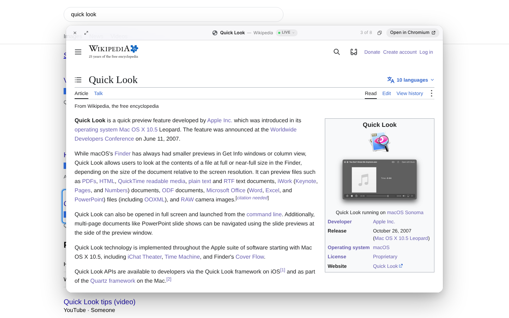
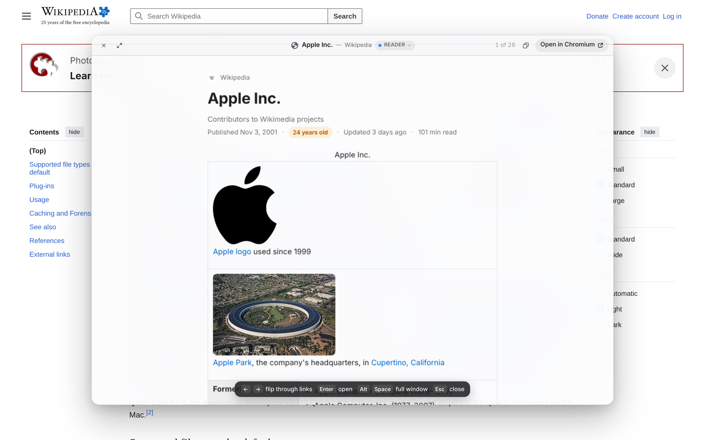
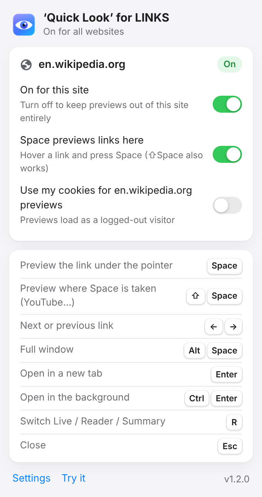

<p align="center">
  
</p>

<h1 align="center">‘Quick Look’ for LINKS</h1>

<p align="center">
  <b>Quick Look for every link on the web.</b><br>
  Hover a link, press <kbd>Space</kbd>, and the page opens in a frosted panel without leaving your tab.<br>
  Use the arrow keys to flip through the other links on the page, the way Finder moves through files.
</p>

<p align="center">
  <a href="../../releases/latest"><b>⬇ Download the latest release</b></a>
  &nbsp;·&nbsp; Chrome, Arc, Brave, Edge and other Chromium browsers (version 116 or later)
</p>

<p align="center">
  
</p>

## Install (about one minute)

You install it from this page, not the Chrome Web Store.

1. **Download.** Open the [latest release](../../releases/latest) and download `quick-look-for-links-vX.Y.Z.zip`.
2. **Unzip it** somewhere you'll keep it, such as your Documents folder. Don't delete the folder later: the browser loads the extension from it.
3. **Open your browser's extensions page** by pasting one of these into the address bar:
   - Chrome: `chrome://extensions`
   - Arc: `arc://extensions`
   - Brave: `brave://extensions`
   - Edge: `edge://extensions`
4. **Turn on Developer mode.** In Chrome it's at the top right; in Edge, at the bottom left.
5. **Click Load unpacked** and choose the unzipped `quick-look-for-links` folder (the one that contains `manifest.json`).
6. **Pick where it works.** The welcome page opens: choose **On every website** or **Only sites I approve**, then try the sample links on that page.

Pin it from the puzzle-piece menu so the toolbar button is one click away.

**Updating:** download the new zip, unzip it over the old folder (or replace that folder), then click the ↻ reload icon on the extension's card in `chrome://extensions`. Your settings are kept.

> Chrome may show a "Disable developer mode extensions" bubble when it starts. That's normal for anything installed this way. Click away from it; the extension keeps working.

## Keys

| Key | What it does |
|-----|--------------|
| <kbd>Space</kbd> | Preview the link under the pointer (or the keyboard-focused link). Press it again, or <kbd>Esc</kbd>, to close |
| <kbd>⇧</kbd> <kbd>Space</kbd> | Preview on sites where Space already has a job (YouTube, Google Docs, Figma…). Works everywhere |
| <kbd>←</kbd> <kbd>→</kbd> <kbd>↑</kbd> <kbd>↓</kbd> | Previous or next link in the same list (search results, a thread, a column of headlines) |
| <kbd>⌥</kbd> <kbd>Space</kbd> | Full window (also <kbd>F</kbd>, or double-click the title bar) |
| <kbd>Return</kbd> | Open in a new tab |
| <kbd>⌘</kbd> <kbd>Return</kbd> | Open in a background tab and keep flipping |
| <kbd>⇧</kbd> <kbd>Return</kbd> | Open in a new window |
| <kbd>R</kbd> | Switch between Live, Reader and Summary |
| <kbd>⌘</kbd> <kbd>C</kbd> | Copy the link |
| <kbd>Page Up</kbd> / <kbd>Page Down</kbd> | Scroll the preview |

On Windows and Linux, use Ctrl for ⌘ and Alt for ⌥. Settings can switch the shortcut to <kbd>Ctrl</kbd> <kbd>Space</kbd> to match PowerToys Peek. Right-clicking a link also offers **Quick Look this link**.

## What a preview shows



- **Live**: the real page, loaded logged out in a sandboxed frame. Many sites (XDA, Apple, GitHub…) tell browsers not to show them inside other pages. For this extension's own sandboxed, logged-out preview, it sets that aside so you see the real page. You can turn this off in Settings. Sign-in-walled social sites (Instagram, Facebook, LinkedIn, X…) open as Summary instead, since logged out they only show a sign-in wall.
- **Reader**: just the article, with its main image, reading time, and how old the page is. Press <kbd>R</kbd> to switch to it.
- **Image, video, PDF**: image links at full size, YouTube through its official privacy-enhanced embed, PDFs in the browser's own viewer.
- **Summary**: the title, description and image a page provides for link previews.
- **Text and files**: JSON and plain text are shown formatted. For download links you see the file's name, type and size, and nothing is downloaded.

The badge in the title bar always says which one you're looking at.

**Buttons and script links.** Many sites use buttons or `javascript:` links instead of real links. If the destination can be read without running the page's script (a `data-href`, a URL inside `onclick`, a GET form), it gets previewed. Otherwise a short note explains why there's nothing to preview. It never presses the button, and sign-out and other action buttons are refused.

**Cross-origin-isolated sites** such as WhatsApp Web work too.

## Privacy and safety



- **Nothing loads on hover.** A preview is fetched only after you press Space.
- **Logged out by default.** Previews send no cookies, and live pages start with an empty cookie jar. You can allow cookies for specific sites in Settings.
- **Sealed off.** Previews render in a locked-down extension frame. Previewed pages can't touch the page you're on or redirect your tab, and other websites can't use the frame.
- **Careful with risky links.** Links that look like sign-out, unsubscribe, delete or one-time sign-in links aren't loaded (you can still choose Preview Anyway).
- **No servers, no analytics.** Nothing leaves your computer except the request to the link you chose. The stats in Settings stay on your computer.
- **Space keeps its job** in text boxes, editors, keyboard-focused buttons, video players and games. On sites where the page itself uses Space (YouTube, Google Docs and a few others by default), use <kbd>⇧</kbd> <kbd>Space</kbd>. The toolbar button can also turn the extension off completely for a site.

### About the permission warning

If you choose **On every website**, Chrome warns that the extension can "read and change all your data on all websites". That's because previewing any link you might hover means fetching from any site. If you'd rather not grant that, choose **Only sites I approve**. You then turn previews on per site from the toolbar button, and approve each new site a preview loads from the first time.

<br clear="right">

## Settings

Open them from the toolbar button or by right-clicking the toolbar icon and choosing **Options**. You can set the trigger key (Space or Ctrl+Space), theme, panel size, Reader font, which sites keep Space for themselves, which sites can use your cookies, and which sites the extension stays off entirely.

## For developers

Plain Manifest V3, with no build step and no dependencies apart from the bundled [Readability](https://github.com/mozilla/readability). Clone the repo and load the folder with **Load unpacked**.

```
background.js        service worker: content-script registration, network rules, tab opening
content/             keyboard model, link sequencing, the panel (closed shadow DOM, top layer)
preview/             the sealed preview frame: fetching, live/reader/media/summary rendering
shared/              settings and link utilities used by every part
popup/ options/ welcome/
```

## License

MIT. See [LICENSE](LICENSE).

## Credits

Made by Shivansh Raj Srivastava. Reader view uses Mozilla's [Readability](https://github.com/mozilla/readability) (Apache License 2.0, see `preview/lib/READABILITY-LICENSE.md`). Quick Look is a trademark of Apple Inc. This project isn't affiliated with or endorsed by Apple.
